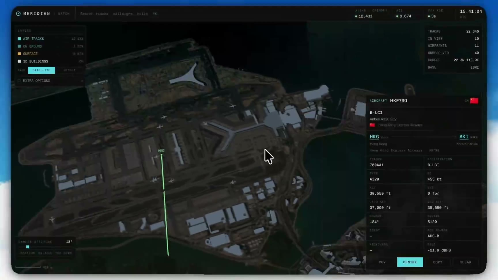
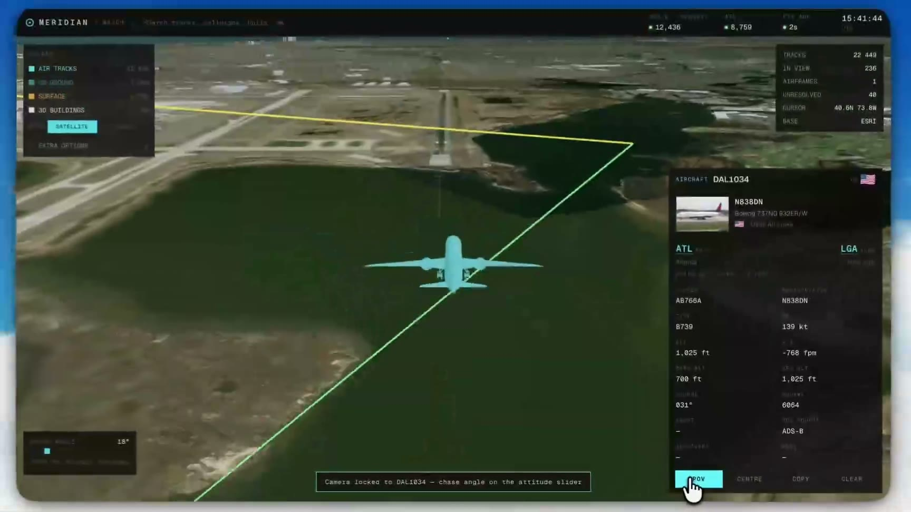
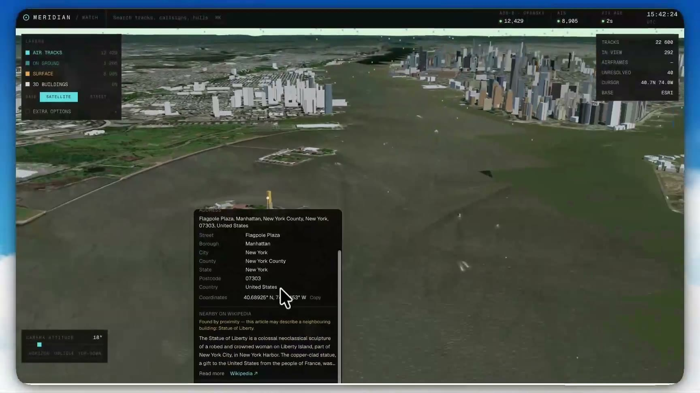

<div align="center">

# 🌍 openworld

**A live, 3D view of the planet's air and sea traffic, built entirely on open and freely available data.**

Every aircraft with a transponder. Every ship broadcasting AIS. Over 300 million buildings.<br/>
Real terrain, real imagery, and real airframe details, on a globe in your browser.

[](https://nextjs.org)
[](https://react.dev)
[](https://cesium.com/platform/cesiumjs/)
[](https://www.typescriptlang.org)
[](https://tailwindcss.com)
[](#-the-open-data-behind-it)

</div>

<br/>

<video src="https://github.com/adwaitgawade/openworld/raw/main/public/compressed-demo.mp4" controls muted playsinline width="100%"></video>

<p align="center"><sub>Video not playing? <a href="public/compressed-demo.mp4">Download the 80-second demo</a>.</sub></p>

<table>
  <tr>
    <td width="33%"></td>
    <td width="33%"></td>
    <td width="33%"></td>
  </tr>
  <tr>
    <td align="center"><sub><b>Pick any aircraft:</b> airframe, operator, route and live telemetry</sub></td>
    <td align="center"><sub><b>POV mode:</b> ride along behind a flight, route drawn at altitude</sub></td>
    <td align="center"><sub><b>Pick any building:</b> address, OSM tags and Wikipedia</sub></td>
  </tr>
</table>

---

## ✨ What it does

openworld has two views.

### `/`: the Meridian watch console

This is a "watch floor" for global traffic. It merges live positions into one stream of tracks and puts them on a 3D earth.

- **✈️ Air tracks.** Live ADS-B positions for aircraft worldwide, both airborne and on the ground. Up close, planes are drawn as true-to-scale 3D 787 models; zoomed out, they become dots.
- **🚢 Surface tracks.** Live AIS position reports from ships, streamed over a WebSocket. The server keeps the latest fix for each vessel.
- **🔎 Selection HUD.** Click a flight to see its registration, airframe type, operator, a photo, its scheduled route (`ATL → LGA`), altitude, speed, vertical rate, squawk and position source.
- **🛫 Live trails.** The selected aircraft's flown path is drawn **at its true altitude**. The route is split at the aircraft's projected position, and the track refreshes every 5 seconds.
- **🎥 POV camera.** Lock the camera behind any track and adjust the chase angle (Horizon, Oblique or Top-down).
- **🚨 Priority queue.** Alerts are derived only from what the feeds actually report:
  - `EMERGENCY SQUAWK` (7500 / 7600 / 7700)
  - `DARK VESSEL` (an AIS gap of 30 minutes or more)
  - `LOITER` near a strategic chokepoint
  - `RENDEZVOUS` (two stopped hulls less than 0.4 nm apart)
  - `COVERAGE GAP`
- **⌘K command palette.** Jump to a track by callsign or hex, an airport by IATA *or* ICAO code, or any place on earth.
- **🏙️ 3D buildings.** Global building footprints extruded to height, with three styles: by type, plain white, or by height.
- **🗺️ Base maps.** Satellite imagery (with optional road and label overlays) or OpenStreetMap.
- **📐 Reference layers.** Major sea lanes, chokepoint labels, and the ocean regions that receivers can't see.

### `/globe`: the explorer

This is a free-roaming globe for exploring places instead of traffic:

- Place search via Nominatim.
- Switchable map stacks and imagery labels.
- 3D building styling, plus a **building details callout**. Click any building to get its address, OSM tags, a Wikidata fact sheet and the Wikipedia lead paragraph.
- **Gaussian splat** 3D Tiles rendered natively by CesiumJS, with adjustable level of detail.

---

## 💡 Why it exists

Tools that show "the whole world, live" are usually closed, paid, or quietly padded with simulated data. openworld asks a simple question: **how much of the planet can you actually see using only open, community-run and freely available data, with no API keys at all?**

It turns out to be a lot. Volunteer ADS-B receiver networks, open AIS streams, OpenStreetMap, Overture Maps, open terrain models and Wikidata together give you a surprisingly complete picture.

The project follows a few principles that show up throughout the code:

1. **Never fabricate.** If a feed is down or unconfigured, its layer stays empty and the health bar says so. Without an AIS key, the surface layer reads `NO KEY`; it does not fill up with invented ships. Every alert in the queue comes from a field a feed actually reported.
2. **Show the gaps.** ADS-B and AIS are receiver-based, so traffic over the open ocean genuinely goes dark. The coverage-gap layer marks those regions instead of letting the map imply uniform global coverage.
3. **Keyless first.** Every core layer works out of the box. Keys only *upgrade* coverage or fidelity; nothing requires one.
4. **Respect the commons.** Rate limits are honored, not worked around. Calls carry an identifying User-Agent where the services ask for one, and attribution is shown.

---

## 🌐 The open data behind it

This is the heart of the project. Every layer below is either **open data** or **free to access without a key**. Where a key unlocks something better, the keyless path is listed too.

### ✈️ Aviation

| Source | What it provides | Access |
| --- | --- | --- |
| **[adsb.fi](https://adsb.fi)** | Open, community-fed ADS-B positions. This is the first keyless provider tried. | 🔓 Keyless |
| **[adsb.lol](https://adsb.lol)** | Live ADS-B positions (the fallback when adsb.fi doesn't answer), per-aircraft live tracks, and airport lookup by ICAO code. A community-run receiver network with an open API (ODbL data). | 🔓 Keyless |
| **[OpenSky Network](https://opensky-network.org)** | Global state vectors in a single call. A research network run by universities and volunteers. | 🔑 Optional (free account) |
| **[adsbdb](https://www.adsbdb.com)** | Mode-S → registration, airframe type, operator and photo. Callsign → scheduled route. This is the only keyless source that knows where an *in-progress* flight is going. | 🔓 Keyless |

> **Keyless air coverage.** Without OpenSky credentials, the console sweeps 20 anchor points over the world's busiest airspace, each with a 250 nm radius. Requests are spaced 1.1 s apart, because these volunteer-run services ask for roughly one request per second. Coverage is therefore dense "bubbles" around major hubs rather than a uniform sheet, and the health bar names the source so that is never hidden. Add free OpenSky credentials to cover the whole planet in one call.

For a deep, verified comparison of what each air feed can and cannot answer, see **[docs/air-feeds.md](docs/air-feeds.md)**.

### 🚢 Maritime

| Source | What it provides | Access |
| --- | --- | --- |
| **[AISStream.io](https://aisstream.io)** | A real-time global AIS firehose over WebSocket. The server holds one whole-world subscription and keeps the latest fix for up to 9,000 vessels. | 🔑 Free key |

### 🗺️ Imagery, terrain and buildings

| Source | What it provides | License / access |
| --- | --- | --- |
| **[OpenStreetMap](https://www.openstreetmap.org)** | Street map base layer. | ODbL · 🔓 Keyless |
| **[Esri World Imagery](https://www.arcgis.com/home/item.html?id=10df2279f9684e4a9f6a7f08febac2a9)** | Satellite base layer, plus transparent road and place-name overlays. *Free to use with attribution, but not open data.* | © Esri, Maxar, Earthstar · 🔓 Keyless |
| **[Re:Earth Terrain](https://reearth.io) / [Mapterhorn](https://mapterhorn.com)** | Global quantized-mesh elevation blended with the EGM2008 geoid. It gives the globe real relief without a key. | CC BY 4.0 · 🔓 Keyless |
| **[Re:Earth Buildings](https://reearth.io)** | 3D Tiles 1.1 building set generated from **[Overture Maps](https://overturemaps.org)** footprints, sitting flush on Re:Earth Terrain. | ODbL · 🔓 Keyless |
| **[Cesium OSM Buildings](https://cesium.com/platform/cesium-ion/content/cesium-osm-buildings/)** | Roughly 350 million OpenStreetMap buildings extruded to their tagged height, used with Cesium World Terrain. | ODbL · 🔑 Optional ion token |

Terrain and buildings are always paired so that buildings never float or sink. Keyless Re:Earth buildings go on keyless Re:Earth terrain, and ion's OSM Buildings go on Cesium World Terrain.

### 📍 Places and knowledge

| Source | What it provides | License / access |
| --- | --- | --- |
| **[Nominatim](https://nominatim.org)** | Place search and reverse geocoding for building addresses. Requests are throttled to 1 req/s for the whole app, as its usage policy requires. | ODbL · 🔓 Keyless |
| **[Wikidata](https://www.wikidata.org)** | Architect, style, heritage status and inception date for notable buildings, via their OSM `wikidata` tag. | CC0 · 🔓 Keyless |
| **[Wikipedia](https://www.wikipedia.org)** | Lead paragraphs for picked buildings, with a nearby-article fallback that is clearly labeled as such. | CC BY-SA · 🔓 Keyless |
| **[Flagpedia / flagcdn](https://flagpedia.net)** | Country flags in the HUD. | Public domain · 🔓 Keyless |

---

## 🧱 Tech stack

| Layer | Choice |
| --- | --- |
| Framework | **[Next.js 16](https://nextjs.org)** (App Router, Turbopack) with the **React Compiler** |
| UI | **React 19**, **[Tailwind CSS 4](https://tailwindcss.com)**, [shadcn/ui](https://ui.shadcn.com) on [Base UI](https://base-ui.com), [Lucide](https://lucide.dev) icons |
| 3D globe | **[CesiumJS 1.144](https://cesium.com/platform/cesiumjs/)**: 3D Tiles, quantized-mesh terrain, glTF models and native Gaussian splats |
| Data layer | Next.js route handlers under `src/app/api` act as a thin server proxy. They hold API keys and the AIS WebSocket, set User-Agents, apply rate limits, and cache responses (stale-while-revalidate for the air feed). |
| 3D assets | A Boeing 787-9 OBJ, converted to a single-mesh `.glb` at install time with [obj2gltf](https://github.com/CesiumGS/obj2gltf) |
| Language | TypeScript 5 |

```
src/
├── app/
│   ├── page.tsx              # Meridian watch console  (/)
│   ├── globe/page.tsx        # Explorer globe          (/globe)
│   └── api/
│       ├── watch/feed/       # merged air + surface snapshot
│       ├── watch/track/      # live trail for one aircraft
│       ├── watch/aircraft/   # airframe + route (adsbdb)
│       ├── watch/airport/    # IATA/ICAO → airport
│       ├── geocode/          # Nominatim search
│       └── building/         # address + Wikidata + Wikipedia
├── components/
│   ├── watch/                # console UI: globe stage, HUD, queue, ⌘K palette
│   └── ...                   # explorer UI: place search, buildings, splats
└── lib/
    ├── watch/                # feed adapters: opensky, adsb, adsbdb, aisstream, alerts
    ├── mapStacks.ts          # imagery + terrain providers
    ├── buildings.ts          # 3D building sources and styles
    └── nominatim.ts, wiki.ts # place and knowledge lookups
```

---

## 🚀 Getting started

**Prerequisites:** Node.js 20.9+ and [pnpm](https://pnpm.io).

```bash
git clone https://github.com/adwaitgawade/openworld.git
cd openworld
pnpm install      # also copies Cesium assets and builds the aircraft model
pnpm dev
```

Open **http://localhost:3000** for the watch console, or **http://localhost:3000/globe** for the explorer.

That's it. **No keys are needed.** Air traffic, terrain, imagery, buildings, place search and Wikipedia all work out of the box.

### Optional keys

Copy `.env.example` to `.env` and fill in only the keys you want:

| Variable | Unlocks | Get one |
| --- | --- | --- |
| `NOMINATIM_CONTACT` | *Recommended.* An identifying User-Agent for Nominatim and Wikimedia, e.g. `openworld (you@example.com)` | No signup needed |
| `AISSTREAM_API_KEY` | The live **ship** layer | [aisstream.io](https://aisstream.io) (free) |
| `OPENSKY_CLIENT_ID` / `OPENSKY_CLIENT_SECRET` | Whole-globe air coverage in one call, instead of hub bubbles | [OpenSky API client](https://opensky-network.org/my-opensky/clients) (free) |
| `NEXT_PUBLIC_CESIUM_ION_TOKEN` | Cesium World Terrain, ion imagery and Cesium OSM Buildings | [Cesium ion](https://ion.cesium.com/tokens) (free tier) |
| `NEXT_PUBLIC_SPLAT_TILESET_URL` / `NEXT_PUBLIC_SPLAT_ION_ASSET_ID` | A Gaussian splat tileset in the explorer. `?splat=<url-or-id>` also works at runtime. | Your own tileset |

### Scripts

| Command | What it does |
| --- | --- |
| `pnpm dev` | Start the dev server |
| `pnpm build` | Production build |
| `pnpm start` | Serve the production build |
| `pnpm lint` | Run ESLint |

---

## 🙏 Credits and attribution

openworld would be nothing without the people who run and feed open data infrastructure:

- The volunteers whose **ADS-B and AIS receivers** feed adsb.lol, adsb.fi, OpenSky and AISStream.
- **OpenStreetMap contributors** and the **Overture Maps Foundation**.
- **[Re:Earth](https://reearth.io)** and **[Mapterhorn](https://mapterhorn.com)** for keyless global terrain and buildings.
- The **Wikidata** and **Wikipedia** communities.
- **[adsbdb](https://www.adsbdb.com)** for route and airframe data.
- **[CesiumJS](https://cesium.com)** for the open-source 3D globe engine.
- The map-stack structure was inspired by [bilawalsidhu/gods-eye-view](https://github.com/bilawalsidhu/gods-eye-view).

Imagery is © Esri, Maxar and Earthstar Geographics. Map data is © OpenStreetMap contributors. Please respect each provider's terms and rate limits if you deploy this publicly.

<div align="center">
<br/>
<sub>Built with open data, for curiosity. ⭐ Star the repo if you enjoyed flying around.</sub>
</div>
